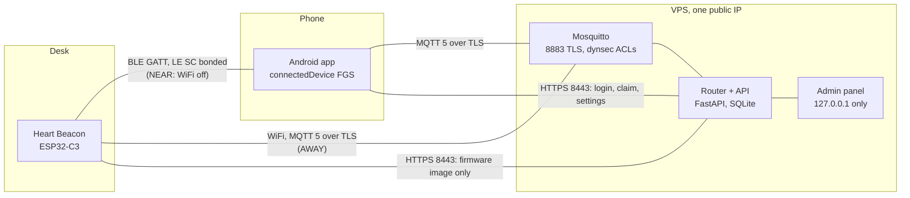
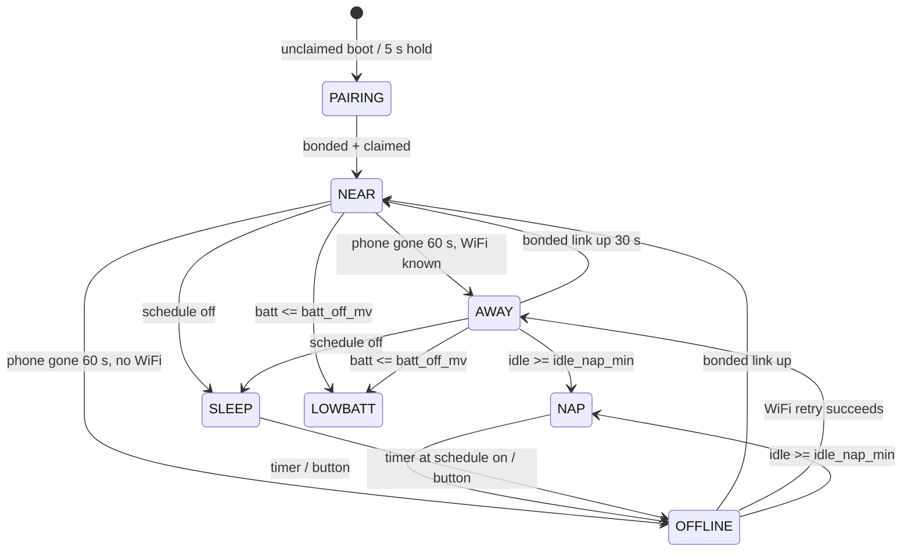

# Heart Beacon v2: implementation plan

Date: 2026-11-23. Scope: new firmware (ESP-IDF), own server (MQTT/TLS + config + admin), Android companion app, one shared protocol contract.

## Summary

1. v2 is three small codebases around one contract (`protocol/PROTOCOL.md` + golden vectors): ESP-IDF firmware, a Python server (Mosquitto + FastAPI + SQLite) on one public-IP VPS, and a Kotlin/Compose app.
2. The beacon has two interchangeable paths to the server: **BLE to the owner's phone** (WiFi off, phone relays) and **its own WiFi + MQTT over TLS**. A server-side router owns delivery, dedupe and receipts, so the paths never need to agree with each other.
3. TLS to a bare IP uses a **private CA pinned in firmware and app**. Per-device and per-user broker credentials with per-client ACLs replace the shared topic and the unauthenticated Telegram bridge.
4. On today's hardware the ungated LEDs (5-9 mA, est.) cap battery life at roughly 4-6 days per 1000 mAh in every state. Firmware removes the v1 waste; a LED load switch on the carrier is what buys weeks.
5. Nine milestones, each bench-verifiable. v1 units migrate **by OTA** (v1 plain-HTTP OTA works), so v2 keeps the existing 1.25 MB slot layout and is size-gated.

## Assumptions

| # | Assumption | Consequence |
|---|---|---|
| A1 | Server is reached by a bare public IPv4, no domain; nothing may depend on the old address. | TLS must validate an IP SAN; server address is config data, never compiled into firmware. |
| A2 | Board is a MakerGO ESP32-C3 SuperMini (4 MB flash, native USB-Serial/JTAG, no 32 kHz crystal) on a carrier with 9 pixels on GPIO2, button GPIO0, divider on GPIO3, GPIO10 spare. | BLE idle current on this board is unproven until measured (M1). |
| A3 | v1 plain-HTTP unsigned OTA works on deployed 0.0.2-0.0.9 units. | Migration is OTA-first; the old OTA endpoint must stay up until the last unit moves. That endpoint is the v1 security gap and is retired in M8. |
| A4 | A handful of users, all onboarded by the admin. No self-signup. | No email, no password reset flow, no multi-tenant design. |
| A5 | The lead's in-place v1 fixes are separate work. | v2 does not depend on them; M8 only needs v1's existing OTA. |

## Architecture





## Decisions

| # | Topic | Recommendation | Trade-off |
|---|---|---|---|
| 1 | Firmware framework | ESP-IDF **v5.3.3** via `idf.py` (installed at `C:\esp\esp-idf`, the version the AI-Notes-recorder firmware builds with), NimBLE (peripheral only), esp-mqtt (MQTT 5), `CONFIG_PM_ENABLE` + tickless idle. All logic in a pure C core driven by one event loop. | Full rewrite of the Arduino sketch; 5.5.x and 6.0.x are newer, but 5.3.3 is installed and proven on the reference hardware. Revisit only if a needed fix lands later. |
| 1b | Power states | PAIRING, NEAR, AWAY, OFFLINE, NAP, SLEEP, LOWBATT (table below). ACTIVE is a transient overlay while an effect plays. | NAP/SLEEP are deep sleep, so the beacon is unreachable until timer or button. |
| 2 | Transport selection | Phone is the gateway whenever a bonded encrypted link is up and the phone reports its server link up; otherwise device WiFi. The **router** tracks each beacon's current path and is the only queue. | Server holds delivery state (about 100 lines) instead of leaning on broker sessions, because a broker session cannot see BLE-path deliveries. |
| 3 | BLE contract | One service, two characteristics (RX write, TX notify), same JSON envelope as MQTT with 1-byte fragmentation header. LE Secure Connections, Just Works, new bonds only inside a button-opened 2 min window. | JSON costs bytes over a compact binary format; in exchange the phone relays payloads verbatim. |
| 4 | Android background | One always-on `connectedDevice` foreground service holding an `autoConnect=true` GATT and the MQTT socket; CompanionDeviceManager association + presence to resurrect it; battery-optimisation exemption. minSdk 34, target 36. | Permanent notification; Android 13 and older excluded. |
| 5 | Security | Private CA (offline root) pinned in firmware + app; per-device and per-user username/password over server-auth TLS; one Mosquitto dynsec role per client; ECDSA-P256 signed config; RSA-3072 signed OTA with rollback. Secure boot and flash encryption **off**. | You own CA rotation; device secrets are readable by someone with the board and a USB cable. |
| 6 | MQTT | Prefix `hb/v1`, per-device and per-user topic subtrees, QoS 1 for everything, retained state + retained signed config, LWT on state. Persistent session for phones only; beacons use clean start and the router flushes pending deliveries when they report online. | Queue depth and expiry live in the router's DB, not in broker config. |
| 7 | Config server | FastAPI + stdlib `sqlite3` (WAL) + Jinja2 admin pages, Mosquitto 2.x with Dynamic Security plugin, two systemd units, no reverse proxy. Admin bound to 127.0.0.1, reached by SSH tunnel. | No admin from a phone browser; SQLite means one box. |
| 8 | Office hours | Schedule in config (days, on, off, tz offset). Time comes from the phone on every BLE connect or a `time` message from the router on MQTT connect. No SNTP. Unknown clock = treat as in-hours. | Deep-sleep wake times drift by minutes on the internal RC clock (est.); resynced on every wake. |
| 9 | Migration | v1 units pull a v2 image through v1's own OTA. v2 keeps the stock 4 MB layout (1.25 MB slots) and fails the build above 1.18 MB. After OTA the unit boots unclaimed and its owner adds it in the app. | One last unsigned plain-HTTP OTA; a tight size budget for the life of rev A. |
| 10 | Hardware | Carrier rev B: high-side load switch on the LED rail driven by GPIO10, default off. Everything else optional. Firmware runs on rev A unchanged. | A respin or a hand bodge per unit. |

Rejected, one line each: Let's Encrypt IP certificates (GA since 2026-01-15, 160 h validity, http-01/tls-alpn-01 only: a renewal outage longer than 6 days cuts off every phone, and it needs port 80/443 open). mTLS client certs (per-unit cert provisioning and revocation for no gain at this fleet size). PlatformIO (lags IDF and hides sdkconfig, which the power work depends on). BLE OTA (1.2 MB over a 500 ms connection interval; WiFi exists). FCM (see open question 5).

## Power

### States

| State | Radios | CPU | Entered when | Wake / exit sources |
|---|---|---|---|---|
| PAIRING | BLE fast adv, connectable | light sleep | unclaimed boot; 5 s button hold | bond + claim; 2 min timeout |
| NEAR | BLE connected, WiFi stopped | auto light sleep | bonded encrypted link + phone `link up`, held 30 s | BLE event, button GPIO, timers |
| AWAY | WiFi STA + MQTT, BLE slow adv | auto light sleep, wakes per listen interval | no phone for 60 s and a known WiFi answers | beacon/DTIM, button, BLE connect |
| OFFLINE | BLE slow adv, WiFi retry with backoff 5 s, 15 s, 60 s, 5 min, 15 min, 30 min cap | light sleep | no phone and no WiFi | backoff timer, BLE connect, button. Never reboots. |
| NAP | none | deep sleep | in-hours, no phone, no button, no heart for `idle_nap_min` | timer every `nap_wake_min` (checks in for 10 s), button |
| SLEEP | none | deep sleep | outside schedule; `sleep` command | timer at next schedule-on, button (stays up 5 min) |
| LOWBATT | none | deep sleep | battery <= `batt_off_mv` | button only (red blink, re-measure) |

Wake-capable button pin: GPIO0 (deep-sleep GPIO wake on C3 covers GPIO0-5).

### Budget per 1000 mAh

Usable capacity taken as 850 mAh (est. derating). LED quiescent floor 7 mA mid, 5-9 mA range (est., from the brief). Board overhead with LEDs gated 0.05 mA (est., SuperMini LDO + divider). Every figure is an estimate unless marked sourced; **M1 replaces this table with measurements**.

| State | SoC current | Basis | Rev A, LEDs ungated | Rev B, LEDs gated | Rev B + 32 kHz crystal |
|---|---|---|---|---|---|
| v1 today (WiFi, CPU never sleeps) | ~30 mA | est. | 37 mA, ~23 h | n/a | n/a |
| NEAR (BLE conn 500 ms, latency 3) | 2 mA (1-3) | est., unproven without a 32 kHz crystal | 9 mA, 94 h (3.9 d) | 2.05 mA, 415 h (17 d) | 0.15 mA, ~236 d |
| AWAY (WiFi listen interval 3 + slow adv) | 3 mA (1.5-4) | est. | 10 mA, 85 h (3.5 d) | 3.05 mA, 279 h (11.6 d) | same as gated |
| OFFLINE (slow adv only) | 2 mA (1-3) | est. | 9 mA, 94 h | 2.05 mA, 415 h | 0.15 mA |
| NAP / SLEEP / LOWBATT | 5 µA | sourced: ESP32-C3 datasheet deep-sleep figure | 7 mA, 121 h (5.1 d) | 0.055 mA, > 1 year (self-discharge limited) | same |
| Office week: 45 h NEAR + 123 h SLEEP | - | computed from rows above | 7.5 mA avg, 113 h (4.7 d) | 0.59 mA avg, ~60 d | 0.08 mA avg, > 1 year |
| One shown heart (3 pulses, 9 px) | ~90 mA for 3 s | est. | 0.075 mAh each | same | 20 a day equals the whole idle budget |

Reading the table: on rev A, schedule and transport choice move battery life from about 3.5 to about 5 days; gating the LEDs moves it to weeks. Light-sleep reference: 130 µA (sourced: Espressif low-power guide). A third-party SuperMini-class board measurement reported 3.6 mA (WiFi) and 9.7 mA (BLE) in light sleep, so NEAR on rev A may be no cheaper than AWAY; it is still required where office WiFi is unusable.

### Latency (all estimates)

| Path | Estimate | Dominated by |
|---|---|---|
| Button to phone, NEAR | <= 0.5 s | connection interval |
| Server to beacon, NEAR | <= 2 s | interval x (latency + 1) |
| Server to beacon, AWAY | 0.3-1 s | WiFi listen interval |
| Button press from deep sleep to published, WiFi | 3-5 s | fast-connect 1-2 s + TLS handshake 1-1.5 s |
| Beacon advertises to usable link, bonded phone | 1-10 s | Android background scan duty vs adv interval |
| Phone notification while phone is in Doze | seconds to minutes | Doze maintenance windows; measured in M5 |

## Protocol contract

`protocol/PROTOCOL.md` is normative; `protocol/vectors.json` is checked by C, Kotlin and Python tests. Pattern taken from `AI-Notes-recorder/protocol/PROTOCOL.md`, `protocol/testdata/test_vectors.json` and `firmware/test/host/test_vectors.c`.

### Envelope (same bytes on MQTT and BLE)

`{"v":1,"t":"<type>","id":"<16 hex>","ts":<epoch s, 0 if clock unknown>, ...}`

Rules: receivers ignore unknown keys; unknown `t` with an `id` gets `resp ok:false`. Additive changes stay `v:1`. A breaking change is `v:2` on prefix `hb/v2`. Max message 1024 B. `did` is `HB-` + last 3 MAC bytes in hex.

| `t` | Direction | Fields | Notes |
|---|---|---|---|
| `mood` | beacon or app -> router; router -> phone | `k`: `heart` \| `sorry` \| `annoy`; `from` (router -> phone only) | tap = heart, double = sorry, triple = annoy |
| `show` | router -> beacon | `k`, `id` = originating event id | beacon dedupes on `id` (ring of 16 in RTC memory) |
| `shown` | beacon -> router | `id` | delivery receipt |
| `rcpt` | router -> sender's phone | `id`, `to`, `st`: `queued` \| `shown` \| `expired` | replaces Telegram's "message sent" |
| `tele` | beacon -> router | `mv`, `pct`, `rssi`, `fw`, `hw`, `cfg`, `up_s`, `rst`, `heap` | every `tele_min`, and on each connect |
| `state` | beacon -> router (retained, LWT) | `st`: state name or `lost`; `path`: `wifi` \| `ble`; `wake` (epoch of next wake) | sent on every transition, before every deep sleep |
| `cfg` | router -> beacon (retained) | `n`, `b` (base64url config bytes), `s` (base64url ECDSA-P256 signature over those bytes) | rejected if signature bad, `did` mismatch, or `n` <= stored |
| `time` | router or phone -> beacon | `ts`, `tz` (minutes) | |
| `sleep` | router -> beacon | `for_s` (0 = until schedule or button) | |
| `get` / `resp` | either -> beacon / beacon -> | `what`; `re`, `ok`, `err`, `d` | `get info` returns `did`, `fw`, `hw`, `pv`, `claimed` |
| `claim` | phone -> beacon, BLE only | `host`, `mport`, `aport`, `user`, `pass` | accepted once; refused until factory reset (guard copied from `firmware/components/provisioning/config_store.c` `config_merge`) |
| `wifi.scan` / `wifi.list` / `wifi.set` / `wifi.forget` / `wifi.use` | phone -> beacon, BLE only | `ssid`, `psk`, `on` | max 4 networks; `wifi.set` replies with join result and reason; PSKs never read back |
| `link` | phone -> beacon; phone -> router | `up` (phone has server link); `did`, `ble` | drives handover |
| `relay` | phone <-> router | `did`, `m` (inner envelope) | wrapper for anything carried over BLE |
| `reset` | phone -> beacon, BLE only | `what`: `wifi` \| `factory` | |

### Transport and handover rules

| Rule | Value |
|---|---|
| Uplink path | BLE if link encrypted and last `link.up` is true; else WiFi. No ack in 5 s: resend same `id` on the other path. |
| Enter NEAR | bonded link + `link up` held 30 s, then stop WiFi. |
| Leave NEAR | link lost: fast advertise 30 s, wait 60 s total, then start WiFi. A pending uplink skips the wait. |
| Phone upstream down 60 s | beacon starts WiFi while keeping BLE. |
| Downlink path (router) | most recently reported live path for that beacon. No `shown` in 10 s: try the other. |
| Dedupe | router: unique (`did`, `id`). Beacon: `id` ring. |
| Ordering | none guaranteed, none needed. Effects are idempotent; the router orders by receive time. |
| Queue while asleep | router holds pending rows up to 24 h and flushes when `state` shows the beacon up. A burst arriving within 3 s plays each `k` once. |

### MQTT topics

Broker: Mosquitto 2.x, MQTT 5, TLS on 8883. Keepalive 240 s for beacons, 120 s for phones. Buffer on the beacon 2048 B.

| Topic | Publisher -> subscriber | QoS | Retain | Carries |
|---|---|---|---|---|
| `hb/v1/d/{did}/up` | beacon -> router | 1 | no | `mood`, `shown`, `tele`, `resp` |
| `hb/v1/d/{did}/state` | beacon -> router, LWT `st:lost` | 1 | yes | `state` |
| `hb/v1/d/{did}/down` | router -> beacon | 1 | no | `show`, `time`, `sleep`, `get` |
| `hb/v1/d/{did}/cfg` | router -> beacon | 1 | yes | `cfg` |
| `hb/v1/u/{uid}/up` | phone -> router | 1 | no | `mood`, `relay`, `link` |
| `hb/v1/u/{uid}/state` | phone -> router, LWT `on:false` | 1 | yes | `{"on":true}` |
| `hb/v1/u/{uid}/down` | router -> phone | 1 | no | `mood`, `rcpt`, `relay`, device status |

| Client | Client id | Session | ACL (one dynsec role each, literal topics) |
|---|---|---|---|
| Beacon | `d-{did}` | clean start | publish `d/{did}/up`, `d/{did}/state`; subscribe `d/{did}/down`, `d/{did}/cfg` |
| Phone | `u-{uid}-{install}` | persistent, expiry 24 h | publish `u/{uid}/up`, `u/{uid}/state`; subscribe `u/{uid}/down` |
| Router | `router` | clean, 127.0.0.1:1883 only | `hb/v1/#` |

The shared topic, the self-echo and random client ids are gone. A press lights the presser's own beacon locally.

### BLE GATT

| Item | Value |
|---|---|
| Service | `48420001-6265-6163-6F6E-763200000000` |
| RX (phone -> beacon) | `48420002-...`, write with response, encryption required |
| TX (beacon -> phone) | `48420003-...`, notify, encryption required |
| Frame | byte 0: bit 7 = more fragments follow, bits 0-6 = message sequence mod 128. Rest: UTF-8 JSON fragment. Reassembly cap 1024 B, 2 s timeout (injected time). No CRC: the encrypted link carries a MIC. |
| MTU | beacon and app request 247. Fragmentation makes any MTU >= 23 work. |
| Versioning | `get info` returns `pv` and `min_pv`; the app refuses to operate below `min_pv` and offers a firmware update. |
| Security | LE Secure Connections, bonding, Just Works (`sm_sc=1`, `sm_bonding=1`, no I/O, as in `firmware/components/sync/ble_gatt.c:1433-1435`). New bonds only inside the pairing window (5 s hold, 2 min, blue pulse). A connection that is not encrypted with an existing bond within 5 s is dropped outside the window. Max 3 bonds, 1 connection. Public static address, so CDM can match by MAC. |
| Advertising | ADV: flags + service UUID. Scan response: name `HB-XXXXXX`. Fast: 100 ms for 30 s after boot, button, disconnect. Slow: 500 ms on rev A (LED floor makes it free), 1000 ms once LEDs are gated. Both are config values. |
| Connection parameters | Phone's defaults for the first 5 s (discovery, MTU). Then the beacon requests 400-500 ms interval, latency 3, supervision timeout 6 s, and re-requests once if refused. The reference does the reverse for bulk transfer (`ble_gatt.c:1308-1315`). |
| Not used | 2M PHY, data length extension, OTA characteristic. |

The pairing window closes the hole that `AI-Notes-recorder/docs/SECURITY-v1.md` lists as future work (a stranger bonding with an unprovisioned unit).

### Config schema v1

Signed by the server, published retained on `d/{did}/cfg`, also handed to the phone for BLE relay. Missing keys take compiled defaults. Raw size <= 1024 B.

```json
{
  "cv": 1, "n": 12, "did": "HB-3FA2C1",
  "srv": {"hosts": ["203.0.113.10"], "mqtt": [8883], "api": 8443},
  "name": "Desk",
  "led": {"bright": 60},
  "sched": {"on": true, "tz": 330, "days": "1111100", "start": "09:00", "stop": "19:00"},
  "pwr": {"idle_nap_min": 90, "nap_wake_min": 15, "batt_low_mv": 3450, "batt_off_mv": 3300, "batt_cal_ppm": 0},
  "ble": {"adv_fast_ms": 100, "adv_fast_s": 30, "adv_slow_ms": 500, "conn_ms": 500, "latency": 3, "sup_ms": 6000},
  "net": {"use_wifi": true, "near_hold_s": 30, "away_grace_s": 60, "tele_min": 30, "wifi": []},
  "fw": {"ver": "2.0.0", "path": "/fw/hb-2.0.0.bin", "sha256": "", "min_mv": 3700}
}
```

| Block | Who edits | Notes |
|---|---|---|
| `srv` | admin | `hosts` is a list so an IP move is a config push made before the move. |
| `name`, `led`, `sched`, `pwr.idle_nap_min`, `net.use_wifi` | user in the app, admin | the app's whole settings surface |
| `pwr` thresholds, `ble`, `net` timings | admin | tuning knobs for real hardware; `batt_cal_ppm` corrects the divider |
| `net.wifi` | admin, optional | pre-provisions a network. Networks added in the app go to the beacon over BLE and are never uploaded. |
| `fw` | admin | desired state. Beacon updates when `ver` differs, it is on WiFi, and battery >= `min_mv`. Never on boot. |

## Server

| Piece | Choice |
|---|---|
| Layout | `server/hb_server/`: `api.py`, `admin.py`, `router.py` (pure `route(event, state) -> publishes` plus thin `aiomqtt` glue), `db.py`, `dynsec.py`, `signing.py`, `models.py` |
| Tables | `user` (name, argon2 hash, circle_id, disabled), `circle`, `device` (did, owner, registered, claimed, cfg_n, cfg_json, last state/tele), `event`, `delivery` (event, target, path, status), `fw_image` |
| Pairing relationship | A user belongs to one circle. A `mood` from any member (beacon or app) goes to every other member's beacons and phones. |
| Device registry | Admin registers a `did` at flash time; only registered, unclaimed `did`s can be claimed. A different user can claim only after the admin releases it. |
| API (8443, TLS with the private-CA leaf, served by uvicorn directly) | `POST /api/v1/login`, `GET /api/v1/me`, `POST /api/v1/devices/claim`, `DELETE /api/v1/devices/{did}/claim`, `GET` and `PATCH /api/v1/devices/{did}/settings`, `GET /api/v1/events`, `GET /fw/{file}` (unauthenticated: images are signed and not secret) |
| Keys | CA root: offline on the dev machine. OTA signing key: offline, used at build. Config signing key and TLS leaf key: on the VPS, mode 600. |
| Deployment | apt `mosquitto`; `hb-api.service` (public 8443) and `hb-admin.service` (127.0.0.1:8444) from one uv project; ufw allows 22, 8883, 8443. Nothing on 80/443. |
| Backups | Nightly `sqlite3 .backup` + dynsec JSON + config, tarred, encrypted with `age`, pushed off-box, 14 kept. Restore is rehearsed in M2. |

### Claim flow

| Step | Actor | Action |
|---|---|---|
| 1 | Beacon | Unclaimed or 5 s hold: pairing window, fast advertising. |
| 2 | App | CDM `associate` filtered on the service UUID, connect, bond, `get info`. |
| 3 | App -> server | `POST /devices/claim {did}`. Server creates the dynsec client and role, a 32-byte password, signed config n=1; returns them. |
| 4 | App -> beacon | `claim`, then `cfg`, `time`, optional `wifi.set` (reply says joined or why not). |
| 5 | App | `startObservingDevicePresence`, start the service. |
| Remove | App | server unclaim (credential deleted), `reset factory`, CDM `disassociate`, remove bond. |

### Admin panel (admin only; screens, not styling)

| Screen | Contents |
|---|---|
| Devices | did, owner, state and path, battery, fw, config n, last seen, asleep-until |
| Device detail | config form (validated, bumps `n`, signs, publishes), send test effect, release claim, rotate credential, telemetry history |
| Users and circles | create user, reset password, disable, assign circle |
| Firmware | upload signed image, set target for one device then for all |
| Events | recent events with delivery status |
| System | broker status, leaf certificate expiry, last backup |

## Android app

| Topic | Plan |
|---|---|
| Modules | `:core` (pure JVM: envelope, frame codec, relay and handover logic, tests) and `:app` (Compose, service, CDM, BLE, MQTT). Toolchain as proven in the reference: AGP 8.9.1, Kotlin 2.1.20 (`android/gradle/libs.versions.toml`). |
| Service | One `connectedDevice` foreground service. No documented time limit for that type; `dataSync` is not used. Prerequisite is the `BLUETOOTH_CONNECT` runtime grant. Started on app open, `BOOT_COMPLETED`, `MY_PACKAGE_REPLACED` and presence callbacks. |
| Presence | `CompanionDeviceService`: `onDevicePresenceEvent` on API 36, `onDeviceAppeared` on 34-35, both calling one idempotent single-flight start. Presence flaps several times in seconds (`android/sync/.../ble/ScanScheduler.kt` records four in 11 s), and the service is started directly rather than through WorkManager (`RecorderPresenceService.kt`). |
| Connection | First connect after adding: `autoConnect=false`. After that one `autoConnect=true` GATT kept open and never closed on link loss; recreated when Bluetooth turns back on. Single GATT owner. Bounded stale-bond recovery as in `ForegroundBleLink.kt`. |
| Server link | Paho MQTT v5 Java client inside the service, trust anchored only on the bundled CA. Credentials in Keystore-backed storage. |
| Doze | Ask for the battery-optimisation exemption at onboarding (reference: `android/app/.../ui/settings/BatteryExemption.kt`). OEM app killers are surfaced on the phone details screen. |
| Permissions | `BLUETOOTH_CONNECT`, `POST_NOTIFICATIONS`, `FOREGROUND_SERVICE`, `FOREGROUND_SERVICE_CONNECTED_DEVICE`, `INTERNET`, `RECEIVE_BOOT_COMPLETED`, `REQUEST_OBSERVE_COMPANION_DEVICE_PRESENCE`, `REQUEST_COMPANION_RUN_IN_BACKGROUND`, `REQUEST_COMPANION_USE_DATA_IN_BACKGROUND`, `REQUEST_COMPANION_START_FOREGROUND_SERVICES_FROM_BACKGROUND`, `REQUEST_IGNORE_BATTERY_OPTIMIZATIONS`. No scan or location permission: CDM does the scan. |
| Storage | DataStore only. Activity list comes from `GET /events` and is cached. |

| Screen | What the user sees |
|---|---|
| Login | username, password (server address comes from the build, editable under an advanced toggle) |
| Home | beacon card (name, Near / Away on Wi-Fi / Asleep until / Offline, battery, last seen); Heart, Sorry, Annoy buttons that work with no beacon; last 20 events with queued and shown marks |
| Add device | permission prompts, "hold the button 5 s until it pulses blue", system chooser, pairing, Wi-Fi pick and password (list scanned by the beacon), name |
| Device settings | name; Wi-Fi (saved networks, add, forget, use Wi-Fi when phone is away); auto on/off timer (days, start, stop, enable); brightness; nap when idle; firmware version and update; remove device |
| App settings | notifications per kind; phone details (model, Android version, app version, Bluetooth state, notification permission, battery-optimisation status, server link state); log out |

## Firmware layout

| Path | Contents | Runs on host |
|---|---|---|
| `fw/components/hb_core/` | `hb_msg.c` (envelope, cJSON), `hb_frame.c`, `hb_button.c` (debounce, edges, tap counts, holds), `hb_fx.c` (non-blocking effects, frame per tick), `hb_batt.c`, `hb_config.c` (parse, defaults, validate), `hb_policy.c` (power states, schedule, nap), `hb_link.c` (path choice, outbox, dedupe ring, WiFi backoff). One entry point: `hb_core_step(state, event, now_ms, actions_out)`. No IDF includes, no clock reads. | yes |
| `fw/components/hb_port/` | `ble_nimble.c`, `wifi.c`, `mqtt.c`, `led_rmt.c`, `adc.c`, `store_nvs.c`, `ota.c`, `sleep.c`. Each posts events to one queue and executes actions. Every wait has a timeout. | no |
| `fw/main/` | queue, main task, Kconfig (`HB_LED_PWR_GPIO` = -1 on rev A, `HB_BTN_GPIO`, `HB_HAS_XTAL32K`) | no |
| `fw/test/host/` | CMake + ctest + vendored Unity, `-Wall -Wextra -Werror` (rig copied from `AI-Notes-recorder/firmware/test/host/CMakeLists.txt`) | yes |
| `fw/sim/` | `hb_sim`: the same `hb_core` objects behind a line-based TCP socket (events in, actions out, time injected). A pytest harness pumps its MQTT actions to a local Mosquitto and its BLE frames to the app's TCP link seam (seam idea from `android/sync/.../TcpDeviceLink.kt` and `:sync:simTest`). The reference simulator is a Python re-implementation; this one is not. | yes |

Partition table: stock arduino-esp32 4 MB default, unchanged (two 1.25 MB app slots), so a v1 unit can take v2 over the air. Build fails above 1.18 MB. The spare `spiffs` area is left alone.

v1 defects and where each is designed out:

| v1 defect | v2 answer |
|---|---|
| WiFi flag never cleared, stuck in MQTT reconnect | `hb_link` owns WiFi state from driver events |
| No WiFi: reboot loop at ~100 mA | OFFLINE with backoff, no reboot |
| OTA check on every boot, plain HTTP, unsigned | desired version in signed config, HTTPS, RSA-3072 verify, rollback |
| Full scan on every connect | BSSID + channel cached in RTC memory, scan only on failure |
| Button without edge detection | `hb_button` |
| Timers count loop iterations, blocking effects | injected `now_ms`, `hb_fx` |
| 256 B MQTT buffer | 2048 B, 1024 B message cap |
| Random client ids, no LWT, QoS 0, shared topic | table above |
| Bridge had no sender auth | per-user credentials and ACLs |
| Battery window shared by all callers | `hb_batt` owns one filter |

## Milestones

One command for everything hardware-free: `./test.sh` (and `test.ps1`) runs firmware ctest, server pytest (in `server/.venv`; `uv run pytest` once uv is installed), Android `./gradlew test`, and from M5 the simulator end-to-end test.

### M0: contract and skeletons

| | |
|---|---|
| Goal | The contract exists and three codebases agree on it byte for byte. |
| Tasks | `protocol/PROTOCOL.md`, `protocol/vectors.json`; `fw/components/hb_core/hb_msg.c`, `hb_frame.c`; `android/core` envelope + frame codec; `server/hb_server/models.py`; root `test.sh` / `test.ps1`. Check in the installed core's sdkconfig whether the stock bootloader has app rollback enabled (file read, no hardware). |
| Host tests | vectors round-trip in C, Kotlin, Python; fragment reassembly incl. timeout and oversize |
| Bench | none |
| Exit | `./test.sh` green from a clean clone |

### M1: firmware core and rev A bring-up, radios off

| | |
|---|---|
| Goal | Button, LEDs, battery, sleep states work; the power table has measured numbers. |
| Tasks | `hb_button.c`, `hb_fx.c`, `hb_batt.c`, `hb_policy.c`; `led_rmt.c`, `adc.c`, `sleep.c`, `store_nvs.c`; `sdkconfig.defaults` with PM + tickless (as in `AI-Notes-recorder/firmware/sdkconfig.defaults`) |
| Host tests | tap / double / triple / holds with bounce; schedule edges incl. midnight wrap and unknown clock; nap entry; battery thresholds with hysteresis; effect frames |
| Bench | Flash one unit over USB. Measure current in light sleep and deep sleep with a meter in the battery lead. Confirm button wake from deep sleep and timer wake. |
| Exit | Measured floor recorded in this document; image boots on the stock bootloader |

### M2: server MVP

| | |
|---|---|
| Goal | Broker, router, claim and config signing work with simulated beacons. |
| Tasks | `deploy/mkca.sh`, `deploy/mosquitto.conf`, systemd units, `dynsec.py`, `db.py`, `router.py`, `signing.py`, `api.py`, minimal admin (devices list, config edit), `deploy/backup.sh` |
| Host tests | router: fan-out per circle, dedupe, path choice, retry on the other path, 24 h expiry, receipts; claim rules; config signature; ACL test against a local Mosquitto (a beacon cannot read another beacon's topics) |
| Bench | From the dev PC over the public IP: TLS connect with the CA succeeds and fails without it; two `hb_sim` instances exchange a heart; restore a backup onto a scratch directory |
| Exit | Above pass against the real VPS |

### M3: firmware WiFi + MQTT (AWAY, OFFLINE)

| | |
|---|---|
| Goal | Two beacons exchange hearts over WiFi through the VPS. |
| Tasks | `hb_link.c`, `hb_config.c`; `wifi.c`, `mqtt.c`; temporary provisioning over the USB console; size gate in the build |
| Host tests | backoff sequence; fast-connect fallback; outbox resend; dedupe ring; config reject cases (bad signature, old `n`, wrong `did`) |
| Bench | Heart both ways; power-cycle the AP and watch backoff with no reboot; pull the server and confirm LWT; measure AWAY current; record image size |
| Exit | 24 h soak with no reset; image <= 1.18 MB |

### M4: firmware BLE (PAIRING, NEAR) and handover

| | |
|---|---|
| Goal | Claim and WiFi setup over BLE; WiFi stops when a phone is the gateway. |
| Tasks | `ble_nimble.c`; pairing window; claim-once guard; `tools/ble_cli.py` (bleak) standing in for the app and relaying to MQTT |
| Host tests | handover hysteresis; pending uplink skips the grace wait; claim refused when claimed; unbonded peer dropped outside the window |
| Bench | Claim and `wifi.set` from `ble_cli.py`; walk away and back, logging path changes; a stranger phone cannot bond outside the window; measure NEAR current; HCI snoop confirms connection parameters; heap low-water with WiFi + BLE + TLS up together |
| Exit | No lost or doubled heart across 20 forced handovers |

### M5: Android app MVP

| | |
|---|---|
| Goal | Login, add device, always-on link, relay, send and receive with notifications. |
| Tasks | `:core` relay logic; service, CDM, BLE link, MQTT, Login / Home / Add device screens. Visual design with the `impeccable` skill starts here. |
| Host tests | relay engine (up, down, `link` reporting, bounded outbox); presence single-flight; frame codec vectors; simulator end-to-end through the TCP seam |
| Bench | Phone near: beacon reports `path: ble` and WiFi current disappears. Force-stop the app, return to the desk, link comes back. Reboot the phone. Overnight screen-off test logging heart-to-notification delay. |
| Exit | Reconnect p95 under 10 s (target, est.); overnight delays recorded and judged against open question 5 |

### M6: schedule, smart power, settings, admin complete

| | |
|---|---|
| Goal | Auto on/off, nap, user settings and the full admin panel. |
| Tasks | settings API and screens; `sleep` handling; queued delivery on wake with coalescing; remaining admin screens |
| Host tests | settings to signed config; flush on `state` up; coalesce burst |
| Bench | A 10-minute schedule cycles SLEEP and wake three times; a heart sent during SLEEP plays once on wake; 48 h soak with current logging |
| Exit | Soak matches the measured table within 20 % |

### M7: signed OTA with rollback

| | |
|---|---|
| Goal | Updates that cannot brick a unit. |
| Tasks | `ota.c` (esp_https_ota, pinned CA, signature verify on update); self-test before marking valid (server link or bonded link within 5 min); admin firmware page; app update row |
| Host tests | update decision (version, battery, path); self-test timer |
| Bench | Good image updates; an image that fails self-test rolls back; power cut mid-download recovers; wrongly signed image is refused |
| Exit | All four cases pass on two units |

### M8: migrate v1 and retire Telegram

| | |
|---|---|
| Goal | Every v1 beacon runs v2; the bridge and old endpoints are gone. |
| Tasks | Rehearse on a bench unit: flash v1 0.0.9, publish the v2 image on the existing OTA path (`version.txt` + `firmware_<ver>.bin`), confirm it boots v2, lands unclaimed and can be claimed. Check whether the last v1 network survives in the WiFi driver's NVS. Register `did`s, create users. Then publish for the fleet; each unit updates on its next boot and its owner adds it in the app. USB flash is the fallback. |
| Afterwards | Stop and disable `telegram_heart`; remove the OTA files and the old HTTP path; close the old broker's port and delete its shared credential; revoke the bot token; update `CLAUDE.md`. |
| Bench | Rehearsal above; after the fleet moves, one week with the bridge stopped but not removed |
| Exit | Admin panel shows every registered unit on v2; nothing listens on the old endpoints |

### M9: carrier rev B (hardware track, independent)

| Item | Today | Recommendation |
|---|---|---|
| LED rail | always powered, 5-9 mA (est.) | High-side load switch or P-FET with a pull-up so it is off by default, driven by GPIO10. Drive the data pin low before switching off. Existing units can be bodged by cutting the LED supply trace. |
| Battery divider | 1:2, values unknown | 1 MΩ + 1 MΩ with 100 nF at the ADC pin, about 2 µA (est.) |
| Regulator | SuperMini onboard LDO, tens of µA quiescent (est.) | Keep. If the battery feeds a different regulator on the carrier, identify it; an AMS1117-class part would cost milliamps. |
| 32 kHz crystal | none | Only on a custom board: crystal on GPIO0/1, button moved to GPIO4 or 5. Decide after M1 and M4 measurements show what NEAR really costs. |
| USB power sense | none | Optional GPIO, so the beacon stays awake and updates while charging. |

Exit: measured SLEEP current under 0.1 mA and the gated column of the power table replaced with measurements.

## Risks

| Risk | Mitigation |
|---|---|
| v2 image outgrows 1.25 MB | Size gate from M3; `-Os`, NimBLE single peripheral, trimmed mbedTLS, WARN logs. If it cannot hold, new units get larger slots by USB and v1 units are flashed by hand. |
| BLE light sleep on a board without a 32 kHz crystal is not low power | Measured in M1/M4 before anything depends on it; NEAR still earns its place where office WiFi is unusable. |
| Office network blocks 8883/8443 or needs a portal | Phone path covers messaging; OTA then needs another network. See open question 3. |
| Doze delays phone notifications | Exemption + measurement in M5; FCM is the only real fix. |
| Server IP changes | `srv.hosts` list pushed ahead of the move; leaf certificate reissued from the same CA. |
| RAM with WiFi + BLE + TLS together | One BLE connection, dynamic mbedTLS buffers, heap low-water in telemetry (the reference repo's `CLAUDE.md` records NimBLE buffer growth costing kilobytes). |
| Stock bootloader lacks rollback | **Checked in M0: enabled.** The installed core (esp32 3.2.1, IDF 5.4.2) sdkconfig `esp32-arduino-libs/idf-release_v5.4-858a988d-v1/esp32c3/sdkconfig` has `CONFIG_BOOTLOADER_APP_ROLLBACK_ENABLE=y` (anti-rollback off, secure boot off). So M7 rollback needs no bootloader change, but the v1 app writes the v2 image as NEW: the v2 app must call `esp_ota_mark_app_valid_cancel_rollback()` after its self-test, including the M8 migration image, or the bootloader returns the unit to v1 on the next reset. Units first flashed with an older core carry that core's bootloader: confirm on the M8 bench unit before the fleet OTA. |

## Sources

- Let's Encrypt, 6-day and IP address certificates GA: https://letsencrypt.org/2026/01/15/6day-and-ip-general-availability.html
- Android foreground service types: https://developer.android.com/develop/background-work/services/fgs/service-types
- Android companion device pairing and presence: https://developer.android.com/develop/connectivity/bluetooth/companion-device-pairing
- `CompanionDeviceService` reference: https://developer.android.com/reference/android/companion/CompanionDeviceService
- ESP-IDF 6.0 announcement: https://www.espressif.com/en/news/ESP_IDF_6.0 and versions page: https://docs.espressif.com/projects/esp-idf/en/stable/versions.html
- ESP32-C3 datasheet (deep-sleep current): https://documentation.espressif.com/esp32-c3_datasheet_en.html
- Espressif low-power introduction (light-sleep current): https://docs.espressif.com/projects/esp-techpedia/en/latest/esp-friends/advanced-development/performance/lowpower/lowpower-fundamental.html

Not verified by a source and marked for checking in the milestone named: `%u` substitution in dynsec ACLs (M2, plan avoids it), v1 WiFi credentials surviving in NVS (M8), Android 16 bond-loss handling (M5). Settled in M0: stock bootloader rollback (enabled, see Risks); ESP-IDF version (pinned to the installed v5.3.3).

## Plan changes after the answers (2026-11-23)

| Change | Why |
|---|---|
| **Broker: a separate Mosquitto instance for v2** on the home server (own config dir, own systemd unit, TLS 8883 + loopback 1883 for the router), not the shared broker. Uses the installed **Mosquitto 1.6.9**: no Dynamic Security plugin, so per-client auth is `password_file` (server-managed, reload via SIGHUP) + a static `acl_file` with `pattern` lines (`%u` = `did` for beacons, `uid` for phones). Router has `topic readwrite hb/v1/#`. Supersedes "dynsec" in Decisions 5 and 7, the topics table and the claim flow. | The shared broker (1.6.9) also serves the water-tank sensor, Frigate and the payload logger; v2 changes must not touch it. 1.6.9 supports MQTT 5 but not dynsec. |
| **Office schedule seed** for both beacons: Mon-Sat 09:00-19:00, tz +330. | User's office hours. |
| **NAP default** still open (lead recommends off by default on rev A: ~25 % saving for up to 15 min latency). Keep it a config value. | Awaiting user. |
| **Parallel tracks**: `feature/v2-fw` (M1 host logic + IDF skeleton build, radios off), `feature/v2-server` (M2 code, no deployment), `feature/v2-app` (M5 groundwork on fakes). `protocol/` is frozen during the round; contract changes are proposed, not edited. Merged into `feature/v2` by the lead. | Three independent codebases sharing one contract. |

## Answers from the user (2026-11-23)

| # | Answer | Consequence for the plan |
|---|---|---|
| 1 | 2 beacons, both owners on Android | M8 is two units; both owners re-add via the app. |
| 2 | All phones Android 14+ | minSdk 34 / target 36 stays. No iPhone path. |
| 3 | Office WiFi: plain password, outbound ports open | AWAY over office WiFi works; NEAR is a power choice, not a necessity. |
| 4 | No hardware change for now | Rev A only; LED floor (5-9 mA est.) stays, so battery life is days, not weeks. M9 parked. Schedule/NAP still worth it but gains are modest; measure in M1. |
| 5 | FCM: decide after measuring | Build without FCM; M5 overnight Doze measurement decides. |
| 6 | One circle, everyone receives | Single circle per user; no per-message targeting. |
| 7 | Missed hearts: play on wake, coalesced, 24 h | As planned (M6). v1.2 already queues via persistent session (uncoalesced). |
| 8 | Server: existing home server | Broker + API on the home box, reached by the home **public IP** with port forwards for 8883/8443. Risk: residential IP may change; keep the `srv.hosts` list in config and an app-side server-address override, and check whether the ISP IP is static before M2. Admin stays SSH-tunnel only. |

## Open questions for the user (answered above)

1. v1 fleet: how many units, where are they, and can each owner install the Android app to re-add their beacon after the OTA?
2. Users and phones: who gets the app, which Android versions and brands, any iPhone? (An iPhone owner gets a WiFi-only beacon and no app in this plan.)
3. Office WiFi: plain password or enterprise / captive portal, and are outbound 8883 and 8443 open? (If not, the phone is the only path at the office.)
4. Hardware: is a carrier respin or a hand bodge for the LED power switch on the table, and what are the battery capacity, divider values and the pin the battery feeds?
5. Push: is Firebase Cloud Messaging acceptable as a wake-up-only fallback if notifications are too slow in Doze, or strictly no Google push?
6. Circles: is "one circle per user, everyone else in it receives" enough, or do you need several circles or one-way sending?
7. Missed hearts: play queued hearts on the next wake (plan default, 24 h, coalesced) or drop anything sent while the beacon sleeps?
8. Server: which VPS and IP, is that IP stable for years, where should off-box backups go, and is SSH-tunnel-only admin acceptable?
